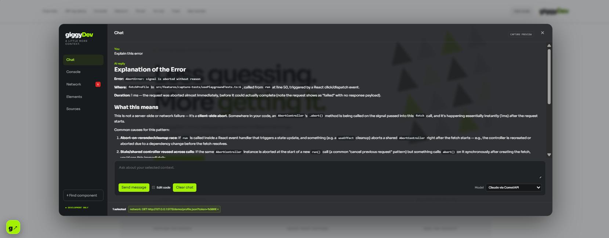

# giggyDev

giggyDev is a development-only debugging overlay for React apps using Vite or Next.js with Webpack.
Inspect browser console logs and network requests, then pick an element to view the JSX behind it.
Send selected context to your AI provider for help diagnosing a problem.
Review a proposed code change in the overlay before applying it, and undo it from the same chat.

## Preview



## Getting started

Use Node.js 20.19 or newer. Start your app in development mode and click the lime giggyDev launcher in your browser.

### Vite

```sh
npm install -D giggydev
```

Add giggyDev before your existing React plugin in `vite.config.ts`.

```ts
import { defineConfig } from 'vite';
import react from '@vitejs/plugin-react';
import giggyDev from 'giggydev/vite';

export default defineConfig({
  plugins: [giggyDev(), react()],
});
```

### Next.js

Use Next.js 16 in Webpack development mode.

```sh
npm install -D giggydev esbuild
```

Wrap your existing configuration in `next.config.mjs`.

```js
import { withGiggyDev } from 'giggydev/next';

export default withGiggyDev({
  // Your existing Next.js options
});
```

Set your app's dev script to `next dev --webpack`, then run `npm run dev`.

## API key setup

Console, Network and the component picker work without an API key. To enable Chat and code fixes, create a key with your provider, choose an exact text model ID and add both to your app's `.env.local`.

```dotenv
GIGGYDEV_AI_PROVIDER=openai
GIGGYDEV_AI_KEY=your-provider-api-key
GIGGYDEV_AI_MODEL=your-provider-model-id
```

Use `anthropic` for Anthropic or `openai-compatible` for a compatible provider. For a compatible provider, also set `GIGGYDEV_AI_BASE_URL` to its API base URL. Restart the dev server after changing environment variables. Keep the key server-side and out of version control.

### Configure multiple models

Create a key and choose text models from your provider's catalog. One option is [CometAPI (affiliate link)](https://www.cometapi.com/?ref=tebogo).

Add the following to `.env.local`.

```dotenv
COMETAPI_KEY=your-cometapi-api-key
```

Pass an `ai.models` list to `giggyDev(options)` on Vite or as the second argument to `withGiggyDev(nextConfig, options)` on Next.js. Add an entry with a unique `id` for each model you want in the Chat dropdown.

```ts
const options = {
  ai: {
    models: [
      {
        id: 'comet-coding',
        label: 'CometAPI coding model',
        provider: 'openai-compatible' as const,
        baseURL: 'https://api.cometapi.com/v1',
        model: 'your-provider-model-id',
        apiKeyEnv: 'COMETAPI_KEY',
      },
    ],
  },
};
```

## Features

| Feature | How to use it |
| --- | --- |
| Console | Open **Console** to inspect browser logs, warnings, errors and stack traces. Search or filter the list, expand a row for details, and tick its box to attach it to Chat. |
| Network | Open **Network** to inspect completed fetch and XHR requests, including failures. Expand a request to see its method, status, duration and captured request payload. Tick its box to attach it to Chat. |
| Component picker | Click **Find component**, then click an element on the page. **Elements** shows the captured DOM details and adds the selection to Chat. Press Escape to cancel picking. |
| Sources | After picking an instrumented JSX or TSX element, open **Sources** to view the original excerpt with the selected line highlighted. Choose **Open in VS Code** to jump to that location. |
| AI Chat | Open **Chat**, choose a model, review the selected context and send your question. Remove any logs, requests or source you prefer to keep out of the request. |
| Reviewed code fixes | Pick the element you want to change, enable **Edit code** in Chat and describe the change. Review the single-file diff, then select **Approve and apply fix**. Use **Cancel** to dismiss a proposal or **Undo** after applying it. |
| Error badge | The launcher badge counts new console errors and failed requests. Open the widget to acknowledge them. |

## Playground

Try the [live playground](https://giggydev.netlify.app/) to trigger sample logs and requests, pick the demo component and explore the widget.
The hosted demo simulates AI replies and lets you review, apply and undo a padding change in the browser.
Run the playground locally to inspect real JSX and try reviewed edits with your own provider key.
See the [playground README](https://github.com/Tebogo11/giggyDev/tree/main/playground#giggydev-playground) for local setup, build and deployment commands.
